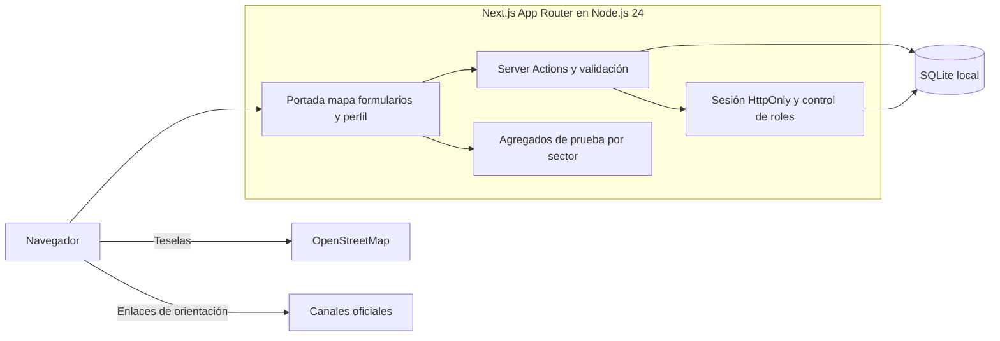
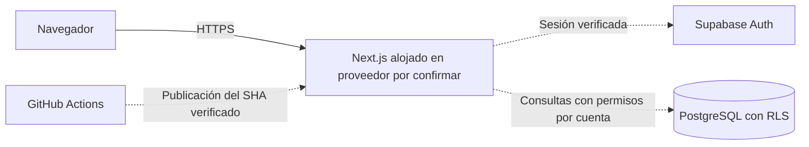

# Arquitectura de SJL Previene

## Piloto local

El servidor valida credenciales y entradas, aplica controles por cuenta y rol, y guarda reportes y auditoría. La interfaz redondea la posición antes de adjuntarla a un reporte. La capa pública usa agregados de prueba con un umbral de cinco. Las teselas de OpenStreetMap aportan la cartografía.

## Arquitectura objetivo

Vercel figura en el plan inicial. Render se evalúa como alternativa. La decisión y la URL quedan registradas en PRAC-16 cuando se comprueben. Supabase cubrirá autenticación, persistencia y límites de acceso con RLS. Las migraciones y la publicación remota siguen pendientes.

| Fase | Control | Evidencia actual |
| --- | --- | --- |
| Plan | Jira, criterios y minimización de datos | Cuatro épicas, trece tarjetas y notas de avance |
| Code | TypeScript, ramas y commits con clave | Git local |
| Build | npm ci, lint, tipos y compilación de Next.js | Verificación local y workflow inicial |
| Test | Sesión, idempotencia, aislamiento y agregación | Recorridos manuales locales. Automatización remota pendiente |
| Release | Checks obligatorios, SAST, dependencias y secretos | Pendiente |
| Deploy | Despliegue del SHA validado y comprobación pública | Pendiente |
| Operate | Logs sin datos personales y rollback | Pendiente |
| Monitor | Registro de SHA, URL, run y checks | Pendiente |
