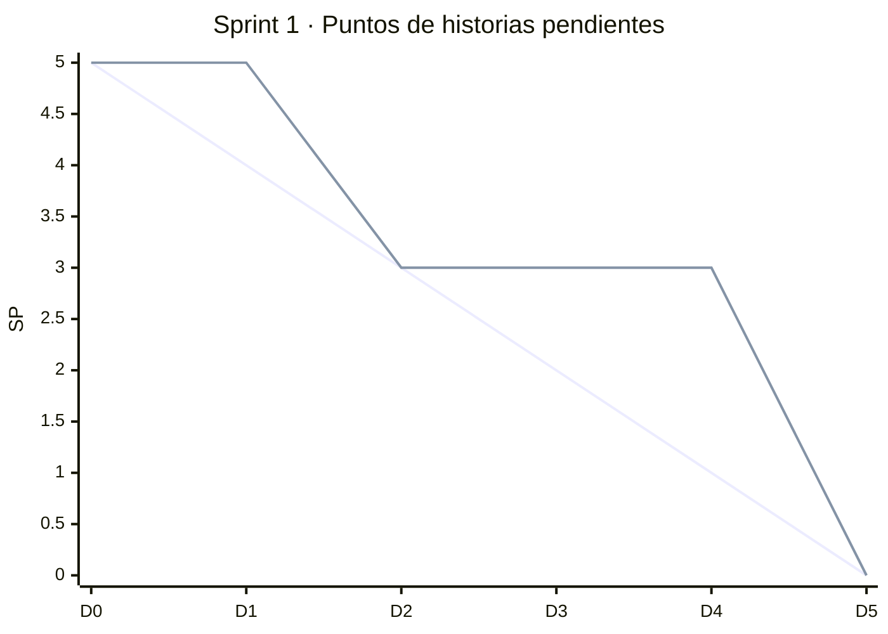
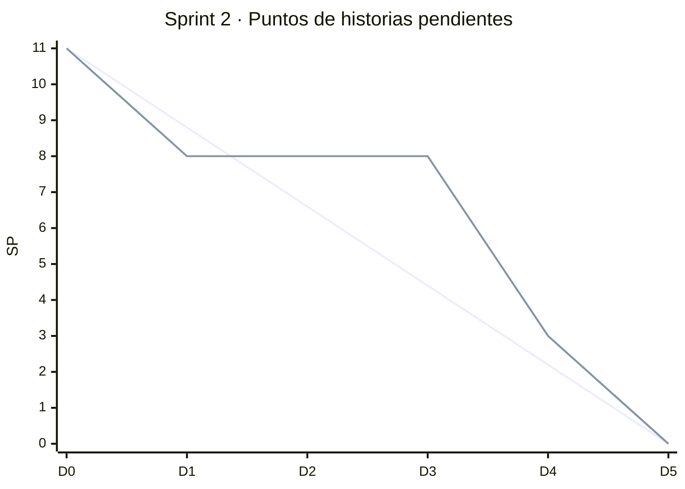
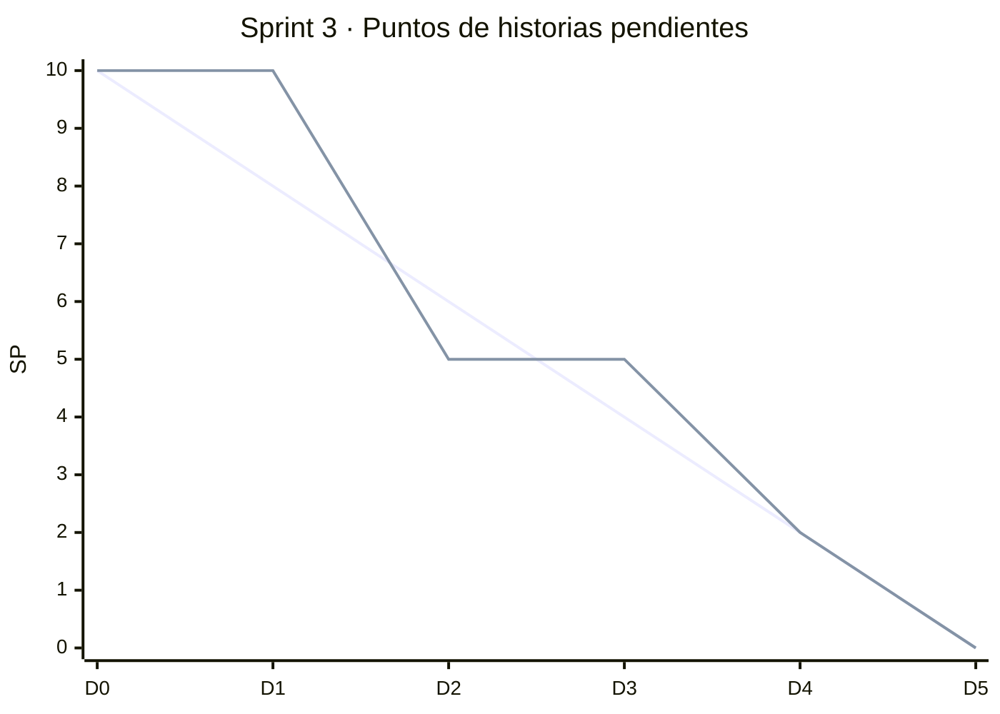
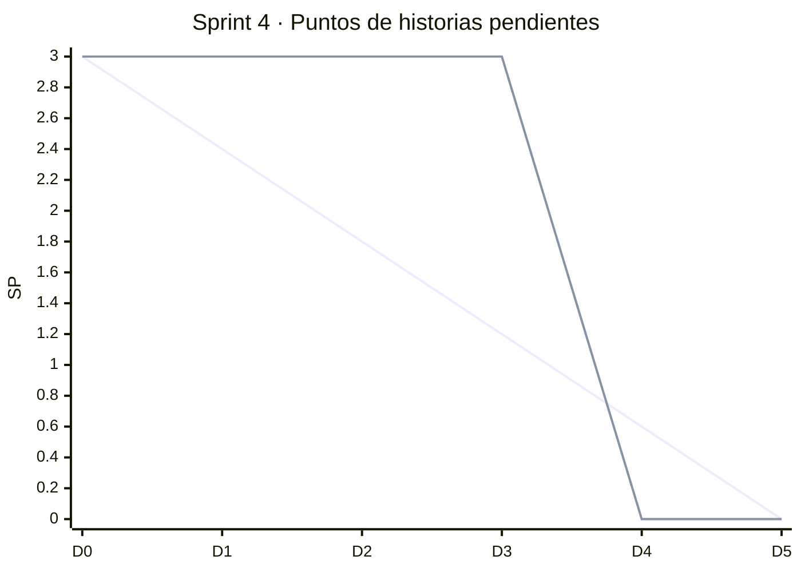
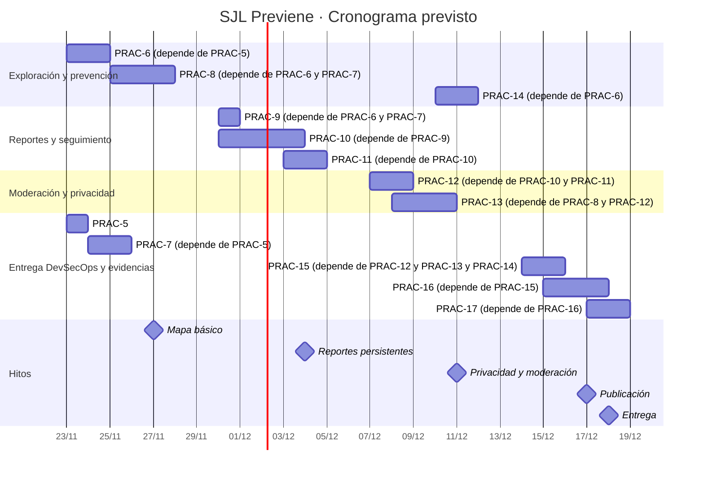

# Gráficos de planificación de SJL Previene

Los cuatro burndowns muestran puntos de historias. Los resultados corresponden a la simulación. La velocidad media es de 7,25 SP por sprint. Los [datos fuente y fechas](sprints.md) permiten reproducir las series.

## Sprint 1

Velocidad simulada de 5 SP. La primera línea es la ideal y la segunda es el avance simulado.

## Sprint 2

Velocidad simulada de 11 SP. La primera línea es la ideal y la segunda es el avance simulado.

## Sprint 3

Velocidad simulada de 10 SP. La primera línea es la ideal y la segunda es el avance simulado.

## Sprint 4

Velocidad simulada de 3 SP. La primera línea es la ideal y la segunda es el avance simulado.

## Gantt previsto

El Gantt usa las claves asignadas por Jira. La última fecha de cada barra en el código es exclusiva, para incluir el día de cierre en la barra. Las dependencias de cada tarjeta aparecen en su rótulo.

